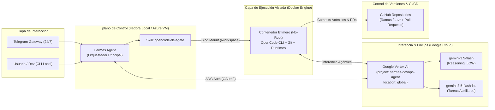

# Hermes DevOps Orchestrator

[](https://cloud.google.com/vertex-ai)
[](https://azure.microsoft.com/)
[](https://www.docker.com/)
[](https://fedoraproject.org/)
[](LICENSE)

Arquitectura híbrida de orquestación de agentes de IA orientada a **DevOps, Automatización e Ingeniería de Software**, diseñada bajo principios de **FinOps**, **mínimo privilegio** y **aislamiento en contenedores Docker**.

Este repositorio documenta la infraestructura, configuración declarativa, decisiones de arquitectura (*ADRs*) y *skills* personalizadas para operar **Hermes Agent** como cerebro orquestador conectado a **Google Cloud Vertex AI** y delegar tareas de ingeniería de código a subagentes efímeros (**OpenCode CLI**) en contenedores aislados.

---

## Arquitectura del Sistema



---

## Stack Tecnológico

| Capa | Tecnología | Propósito en la Arquitectura |
| :--- | :--- | :--- |
| **Sistema Operativo Host** | Fedora Linux 44 (`fish` shell) / Ubuntu LTS (Azure) | Entorno de desarrollo local y nodo cloud 24/7 |
| **Agente Orquestador** | [Hermes Agent](https://github.com/NousResearch/hermes-agent) | Gestión de sesiones, memoria SQLite, delegación de tareas y pasarela Telegram |
| **Proveedor LLM & FinOps** | Google Cloud Vertex AI (`aiplatform.googleapis.com`) | Inferencia con `gemini-3.5-flash` y `gemini-3.5-flash-lite` cubierta por créditos GCP |
| **Autenticación Cloud** | GCP Application Default Credentials (ADC) | Autenticación segura sin API Keys estáticas expuestas en código |
| **Sandboxing & Subagente** | Docker Engine + OpenCode CLI | Ejecución aislada de generación/refactorización de código sin permisos `root` |
| **Infraestructura Cloud** | Microsoft Azure (VM B2s + NSG + SSH Hardening) | Despliegue continuo del orquestador y pasarela de mensajería |
| **Flujo GitOps** | Git + GitHub CLI (`gh`) | Convención de ramas, *Conventional Commits* y automatización de Pull Requests |

---

## Estructura del Repositorio

```text
hermes-devops-orchestrator/
├── config/
│   ├── .env.example          # Plantilla sanitizada de variables de entorno (Vertex AI, Docker, Telegram)
│   └── config.example.yaml   # Configuración base de Hermes Agent (FinOps + backend Docker)
├── docs/
│   └── adr/                  # Architecture Decision Records (decisiones técnicas y financieras)
│       ├── 001-vertex-ai-finops.md
│       └── 002-docker-sandboxing.md
├── scripts/                  # Scripts de automatización, aprovisionamiento y diagnóstico
├── skills/                   # Skills personalizadas de Hermes (ej. opencode-delegate)
├── .gitignore                # Reglas estrictas de bloqueo de secretos, credenciales JSON y estados
└── README.md                 # Documentación principal del proyecto
```

---

## Guía de Despliegue y Configuración

### 1. Prerrequisitos
* **Linux** (Fedora 44 / Ubuntu 22.04+) con `git`, `gh`, `docker` y `gcloud` CLI instalados.
* Proyecto activo en **Google Cloud Platform** con la API `aiplatform.googleapis.com` habilitada.
* **Hermes Agent** instalado en `~/.hermes/`.

### 2. Autenticación en Google Cloud (ADC)
En lugar de utilizar llaves estáticas de AI Studio, autenticamos el entorno mediante **Application Default Credentials**:

```bash
gcloud auth login
gcloud config set project hermes-devops-agent
gcloud auth application-default login
gcloud services enable aiplatform.googleapis.com
```

### 3. Configuración de Hermes Agent
Copia las plantillas sanitizadas de este repositorio hacia tu directorio de configuración local:

```bash
cp config/.env.example ~/.hermes/.env
cp config/config.example.yaml ~/.hermes/config.yaml
```

Edita `~/.hermes/.env` ajustando la ruta local de tu archivo `application_default_credentials.json` y, opcionalmente, el token de tu bot de Telegram.

### 4. Despliegue en Nube (Hito 3 — Microsoft Azure)
1. Aprovisionar VM Linux en Azure con grupo de seguridad de red (**NSG**) restringido exclusivamente a SSH por llave pública (`ed25519`).
2. Instalar Docker Engine (modo sin privilegios `root`) y Hermes Agent.
3. Sincronizar este repositorio y levantar el servicio de `hermes gateway` conectado a Telegram y Vertex AI.

---

## Índice de Architecture Decision Records (ADRs)

Las decisiones arquitectónicas clave del proyecto están documentadas bajo el formato estándar de ingeniería en [`docs/adr/`](docs/adr/):

* **[ADR-001: Migración a Google Cloud Vertex AI con ADC bajo Estrategia FinOps](docs/adr/001-vertex-ai-finops.md)** — Justificación financiera y técnica del paso de Google AI Studio a Vertex AI para capitalizar créditos mensuales del *Google Developer Program* con control estricto de cuotas y costos por token.
* **[ADR-002: Aislamiento de Subagentes de Código (OpenCode) en Contenedores Docker sin Privilegios](docs/adr/002-docker-sandboxing.md)** — Diseño de seguridad para ejecutar herramientas de modificación de código y terminal dentro de contenedores efímeros `non-root` con montajes restringidos.

---

## Hoja de Ruta (Roadmap)

- [x] **Hito 0 — Entorno Local y FinOps:** Instalación de Hermes Agent en Fedora 44, configuración de `gcloud` ADC y validación de consumo en Vertex AI (`hermes-devops-agent`).
- [x] **Hito 1 — Repositorio DevOps y Documentación:** Estructura base, protección de secretos, diagramas de arquitectura e historial de ADRs.
- [ ] **Hito 2 — Sandboxing con Docker + OpenCode:** Construcción de imagen Docker rootless con OpenCode CLI y creación de la skill `opencode-delegate`.
- [ ] **Hito 3 — Despliegue en Azure (IaC):** Aprovisionamiento automatizado de VM en Azure, hardening SSH/NSG e integración con Telegram Gateway 24/7.

---

## Autor

**Anderson Brayan Aranda Delgado** (`@AnderAD21`)  
Ingeniería Informática — Universidad Nacional de Trujillo (UNT, Perú)  
Enfoque en *DevOps, Cloud Engineering & AI Automation*.
